# 26-10-14: Group Meeting Notes

Follow-up to the **26-10-08 checklist**, prepared 2026-10-15.
Figures and numbers are collected from the saved calculations, not new front solves.
Box and Overleaf transfer status follows the completed checklist; the local files are linked here.

## Checklist

| | Meeting item | Result |
|---|---|---|
| 1 | [Thermal gluons in the bag EOS](#item-1) | Established practice in relevant combustion papers; retain the current term. |
| 2 | [Replace the rate prefactor by the baryon-potential approximation](#item-2) | Reduces the Eq. (23) overestimate, but does not recover unequal-flavor phase space. |
| 3 | [Share full phase-space results](#item-3) | Reproducible 60-state CSV package and ZIP prepared for collaborator checks. |
| 4 | [Isothermal rate comparison through 100 MeV](#item-4) | Four temperature panels, all normalized to the exact phase-space estimate. |
| 5 | [Add the adiabatic comparison](#item-5) | Conserved EOS trajectories with local diffusion retained inside the integral. |
| 6 | [Mean free path versus layer thickness](#item-6) | Tail and core tests distinguished; a separate core-tolerance curve is available. |
| 7 | [Isothermal log-temperature plot](#item-7) | Saved analytical curves, numerical curves/dots, and PDF export collected. |
| 8 | [Check the choice of the profile factor](#item-8) | The current value is within 0.5% of the minimum fitting objective over 50–2000 m/s. |

Additional check, 2026-10-16: [accuracy of the isothermal composition ceiling in Eq. (35)](#aiso-accuracy).

**Main message for the meeting:** the unequal-flavor rate correction is real, and the chemical-potential prefactor explains only part of it.
The speed comparisons isolate the rate contribution with shared interface/profile factors; they do not yet include a rate-dependent change of the full front solution.

---

## 1. Thermal Gluons: Keep the Current EOS

The current ideal, massless, unpaired bag EOS includes free thermal gluons:

$$
P_{\rm QM}=-U_{\rm bag}
+\sum_{f=u,d,s}\left[\frac{\mu_f^4}{4\pi^2}+\frac{\mu_f^2T^2}{2}+\frac{7\pi^2T^4}{60}\right]
+\underbrace{\frac{8\pi^2T^4}{45}}_{P_g}.
$$

The combined pure thermal term is $19\pi^2T^4/36$, rather than the quark-only $7\pi^2T^4/20$.
Pressure, energy, and entropy already include the gluon contribution consistently in the production EOS.

| Checked reference | Evidence |
|---|---|
| [Madsen (1999), review](https://doi.org/10.1007/BFb0107314) | Eqs. (62)–(65) give the massless quark gas, explicit gluon potential, and combined three-flavor thermal coefficient. |
| [Buballa (2005), review](https://doi.org/10.1016/j.physrep.2004.11.004) | Eqs. (2.4)–(2.6) separate bag energy, free quarks/antiquarks/gluons, and interaction corrections. |
| [Niebergal, Ouyed and Jaikumar (2010)](https://doi.org/10.1103/PhysRevC.82.062801) | Eq. (5) has the enthalpy coefficient corresponding to the same gluon-inclusive pressure. |
| [Herzog and Röpke (2011)](https://doi.org/10.1103/PhysRevD.84.083002) | Eqs. (1)–(3) explicitly use the same three-flavor thermal coefficient. |

This establishes a relevant precedent, not a universal convention for every effective bag model.
The thermal gluon gas is distinct from both the bag vacuum energy and QCD interaction corrections to the weak rate.
It vanishes at zero temperature and enters beyond the quadratic-temperature analytical EOS truncation.

At $\mu_B=1200\,\mathrm{MeV}$ and equal flavor potentials, its size relative to the **leading quark thermal pressure correction**, not the total pressure, is:

| Temperature | $P_g/(\mu_B^2T^2/6)$ |
|---|---:|
| 10 MeV | 0.0731% |
| 50 MeV | 1.83% |
| 100 MeV | 7.31% |

> **Say:** Keeping the gluon term is consistent with our chosen EOS and directly relevant literature. Removing it would change finite-temperature thermodynamics and require recalculating profiles; this audit gives no reason to do that.

Source: [thermal-gluon literature audit](wiki/physics/bag-model-thermal-gluons.md).

---

## 2. Why Eq. (23) Is Larger Than the Full Rate

All comparisons use the same neutral massless state, with positive net rate for $d+u\rightarrow s+u$:

$$
n_f=\frac{\mu_f^3}{\pi^2}+\mu_fT^2,\qquad
n_u=n_B,\quad n_d=n_B(1+a),\quad n_s=n_B(1-a),
$$

$$
\mu_B=\mu_u+\mu_d+\mu_s,\qquad \mu_K=\mu_d-\mu_s.
$$

**The four curves mean:**

| Curve | Rate prescription |
|---|---|
| Black solid, circles | Exact finite-temperature phase-space quadrature for the specified tree-level four-quark channel. |
| Blue dashed, squares | Madsen Eq. (23), using the actual neutral-state up-quark chemical potential. |
| Orange dotted, triangles | Derived exact cold rate plus the quadratic thermal term. |
| Green dash-dot, diamonds | Eq. (23) with only its fifth-power prefactor replaced; all other local state variables are unchanged. |

The blue and green prescriptions are

$$
\Gamma_{23}=\mathcal C_K\mu_u^5\mu_K(\mu_K^2+4\pi^2T^2),
\qquad
\Gamma_{23,\mu_B/3}=\mathcal C_K\left(\frac{\mu_B}{3}\right)^5\mu_K(\mu_K^2+4\pi^2T^2).
$$

### Relative to the Exact Rate

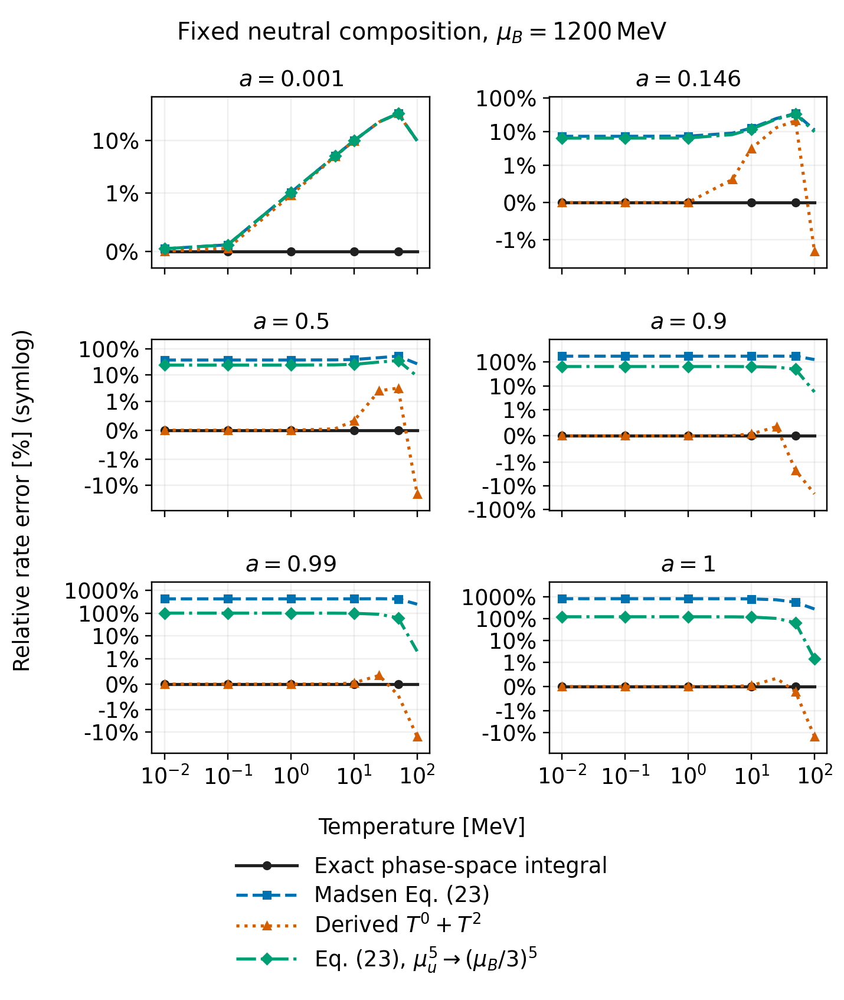

*Standalone derivation, Fig. 3. Error means $100(\Gamma_{\rm model}/\Gamma_{\rm exact}-1)$; the black curve is zero by definition. The vertical scale is symmetric-logarithmic, with ordinary percentage labels.*

Representative **local rate errors** at $\mu_B=1200\,\mathrm{MeV}$ and $T=1\,\mathrm{MeV}$:

| Composition | Eq. (23) | Modified prefactor | Derived cold + quadratic |
|---|---:|---:|---:|
| 0.146 | +7.31% | +6.46% | +0.0052% |
| 0.5 | +37.95% | +24.36% | +0.00042% |
| 0.9 | +178.22% | +65.11% | +0.00011% |

The prefactor substitution lowers the rate at these states, but a large discrepancy remains at high composition.
Eq. (23) assumes nearly equal flavor potentials in addition to a degenerate low-temperature regime.
Neutral matter away from equilibrium has $\mu_s<\mu_u<\mu_d$; changing one prefactor cannot restore the actual flavor-dependent occupation boundaries and angular phase space.

The derived result, at fixed flavor potentials, is

$$
\boxed{\Gamma_K=\frac{45}{128}\mathcal C_K
\left[\mathcal I_0+\frac{\pi^2T^2}{6}\mathcal J_2+o(T^2)\right].}
$$

Here $\mathcal I_0$ is the exact cold phase-space polynomial, including its branch change, and $\mathcal J_2$ is the four-threshold thermal coefficient.
Their explicit expressions are placed together in the manuscript's [collected-results page source](ref-list/massless-weak-rate/collected-results.tex).
The general fixed-splitting remainder starts at cubic order; a quadratic truncation is not uniformly accurate near every threshold or near equilibrium.
The strict expansion at fixed $\mu_B,\mu_K$ additionally includes the EOS chain-rule term in Eq. (6.3).
The plotted orange prescription instead evaluates the displayed coefficients at the same finite-temperature flavor potentials as the other curves.

> **Say:** The prefactor accounts for part of the excess. The remaining error comes from using a nearly-equal-flavor phase-space approximation in strongly unequal-flavor matter.

Sources: [derivation PDF](ref-list/massless-weak-rate/Main.pdf), [numerical summary](wiki/physics/massless-finite-temperature-weak-rate.md), and [fresh benchmark CSV](local_analysis_results/26-10-15/massless-phase-space/phase-space_all.csv).
“Exact” throughout these notes means exact phase space within the massless, unpaired, tree-level four-quark model; it excludes QCD rate corrections and additional antiquark collision channels.

---

## 3. Full Phase-Space Data for Collaborators

**Package:** [shareable ZIP](local_analysis_results/26-10-15/massless-phase-space.zip), [README and normalization](local_analysis_results/26-10-15/massless-phase-space/README.md), [combined CSV](local_analysis_results/26-10-15/massless-phase-space/phase-space_all.csv), and [convergence checks](local_analysis_results/26-10-15/massless-phase-space/convergence.csv).

The package contains **60 freshly calculated states**:

- Two baryon chemical potentials: $900,1200\,\mathrm{MeV}$.
- Three compositions: $0.146,0.5,0.9$.
- Ten temperatures: $0,0.01,0.1,1,5,10,20,25,50,100\,\mathrm{MeV}$.

Each row supplies the flavor potentials, raw forward/reverse/net phase space, weak normalization, and all four comparison rates.
The occupation factors are full Fermi–Dirac distributions: the pair-momentum integrals are analytical, while the remaining two-dimensional integral is numerical, without a temperature expansion.
The reverse rate is obtained by detailed balance, not by a separately performed reverse-channel quadrature.

| Exported quantity | Natural-unit dimensions |
|---|---|
| Raw phase-space integral | $\mathrm{MeV}^8$ |
| Weak prefactor, including the stated spin/color normalization | $\mathrm{MeV}^{-4}$ |
| Physical net rate | $\mathrm{MeV}^4$ |

Order/tail refinements pass the $10^{-6}$ comparison tolerance.
The package also passes 12 independent three-dimensional checks, six cold-polynomial checks, and comparison with the 48 overlapping manuscript-grid states.
Source snapshots and settings are bundled so collaborators can reproduce the convention rather than infer it from a plot.

> **Say:** These are numerical integral values with the state and normalization supplied, not digitized curves. The local ZIP is the reproducible package corresponding to the completed Box-sharing item.

---

## 4. Isothermal Speed Sensitivity Through 100 MeV

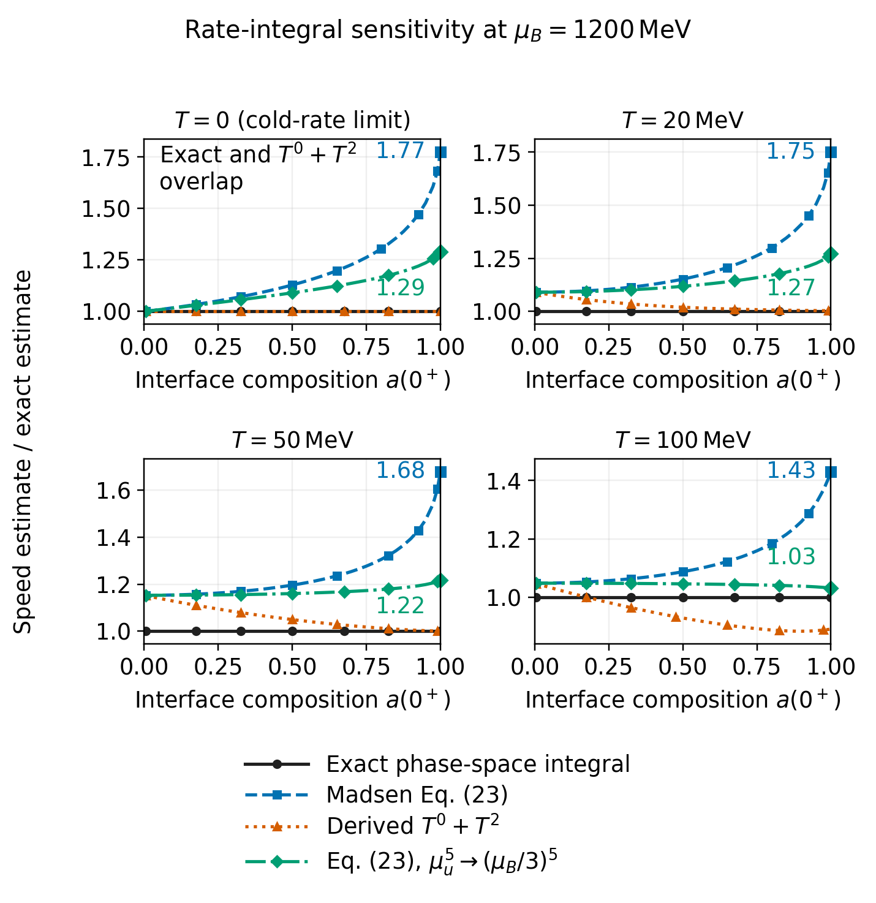

*Standalone derivation, Fig. 4. The endpoint markers give finite limiting ratios; the exact reference is one.*

The plotted quantity is

$$
\frac{u_{\rm model,est}(0^-)}{u_{\rm exact,est}(0^-)}
=\left[
\frac{\displaystyle\int_0^{a(0^+)}\Gamma_{K,\rm model}(a)\,da}
{\displaystyle\int_0^{a(0^+)}\Gamma_{K,\rm exact}(a)\,da}
\right]^{1/2},
\qquad \mu_B=1200\,\mathrm{MeV}.
$$

Temperature and the common diffusion/density/interface/profile factors are held fixed between models.
Neutral flavor potentials are recomputed at each composition.
This is a **rate-integral sensitivity**, not a re-solved spatial BVP or a reconstructed constant-pressure trajectory.
The subscript “est” refers to that shared-profile speed approximation, even when the rate itself is exact.

For $a(0^+)=0.9$, the percentage changes relative to the exact estimate are:

| Temperature | Eq. (23) | Derived cold + quadratic |
|---|---:|---:|
| Cold-rate limit | +42.41% | 0.00% |
| 20 MeV | +40.90% | +0.51% |
| 50 MeV | +39.35% | +0.51% |
| 100 MeV | +25.89% | −11.58% |

At $a(0^+)=1$, the blue ratio is finite: **1.77, 1.75, 1.68, and 1.43** in the four panels.
The green ratios are **1.29, 1.27, 1.22, and 1.03**.
Finiteness of a ratio does not establish a finite absolute front speed at the endpoint.
Agreement or crossing at high temperature also does not establish a controlled low-temperature expansion.

> **Say:** The hot panels extend the same rate-only comparison, rather than claiming that a quadratic expansion or the entire front approximation is valid to 100 MeV.

Sources: [full benchmark table](ref-list/massless-weak-rate/speed-sensitivity-results.tex), [three-model CSV](ref-list/massless-weak-rate/results/speed-sensitivity.csv), and [modified-prefactor CSV](ref-list/massless-weak-rate/results/speed-sensitivity-eq23-muB.csv).

---

## 5. The Missing Adiabatic Comparison

The adiabatic calculation is separate from the fixed-temperature panels.
It imposes a **cold quark interface**, $T(0^+)=0$, and reconstructs a conserved EOS trajectory from upstream neutron matter:

$$
P(a)=P(0^-),\qquad
\frac{h(a)}{n_B(a)}=\frac{h(0^-)}{n_B(0^-)}.
$$

For this massless bag EOS, $h=4(P+U_{\rm bag})$, so constant quark-side baryon density follows from these constraints.
Temperature and chemical potentials vary along the path; the equilibrated downstream temperature is an output.
The calculation uses QMC-RMF3 pure neutron matter and $U_{\rm bag}^{1/4}=189.1566\,\mathrm{MeV}$.

Local diffusion remains inside the integral:

$$
I_{2,\rm model}=\frac1{n_B}\int_0^{a(0^+)}D_K(a)\Gamma_{K,\rm model}(a)\,da,
\qquad
\frac{u_{\rm model,est}(0^-)}{u_{\rm exact,est}(0^-)}
=\sqrt{\frac{I_{2,\rm model}}{I_{2,\rm exact}}}.
$$

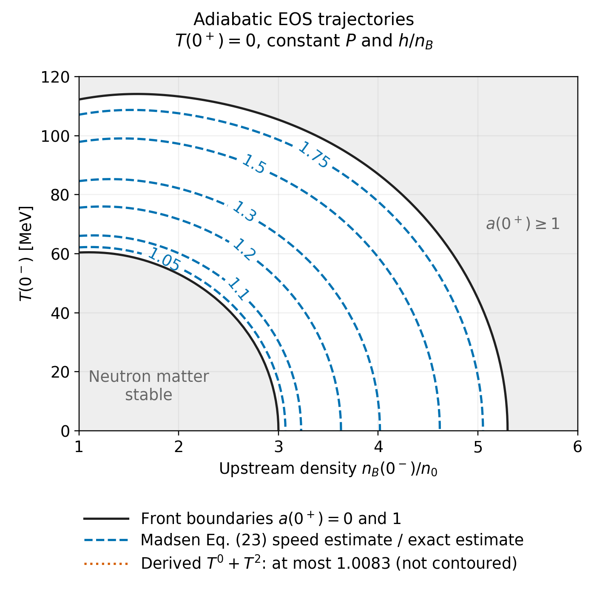

*Standalone derivation, Fig. 5. Blue contours give the Eq. (23)/exact estimate ratio. The derived cold-plus-quadratic ratio is at most 1.0083 over the computed compositions, so it is not separately contoured.*

| Interface composition | Eq. (23) speed change | Derived cold + quadratic |
|---|---:|---:|
| 0.146 | +3.70% | +0.35% |
| 0.5 | +16.66% | +0.81% |
| 0.9 | +56.11% | +0.46% |

At fixed interface composition, these ratios are invariant under the energy rescaling of the massless cold-interface problem.
Their repetition across upstream temperatures is a scaling result, checked with independent dimensional integrations, rather than many unrelated EOS confirmations.
At $T(0^-)=100\,\mathrm{MeV}$, the searched density range only reaches $a(0^+)\gtrsim0.8794$; the two smaller benchmark compositions are unavailable on that slice.

### Why Diffusion Weighting Matters

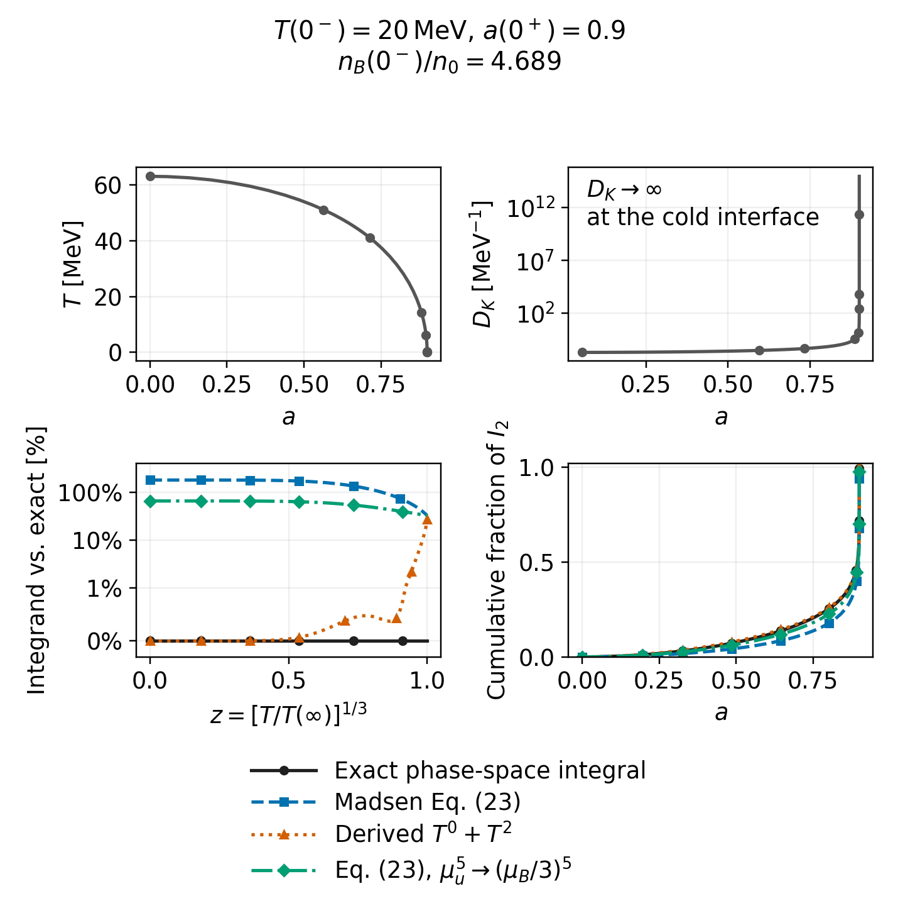

*Standalone derivation, Fig. 6: $T(0^-)=20\,\mathrm{MeV}$ and $a(0^+)=0.9$.*

The cold, unequal-flavor part receives extra weight from the large local diffusion coefficient.
On this trajectory, the blue speed ratio is **1.561**, while the modified-prefactor green ratio is **1.252**.
Replacing local diffusion with one common constant on the same path lowers the blue ratio to **1.327**.
The cold-endpoint integral converges with the stated transport law; convergence alone does not prove that local diffusion remains physically valid at a zero-temperature interface.

> **Say:** The adiabatic comparison is now included, with the temperature rise and diffusion weighting. It is still a common-trajectory, common-profile-factor sensitivity, not a new BVP solution for each rate.

Sources: [adiabatic derivation and figure definitions](ref-list/massless-weak-rate/adiabatic-section.tex), [benchmark table](ref-list/massless-weak-rate/adiabatic-results.tex), and [physical audit](wiki/physics/adiabatic-weak-rate-sensitivity.md).

### Support for Freezing the Baryon Chemical Potential

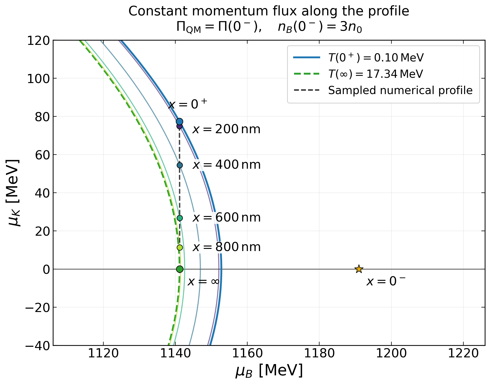

The original plot was produced in [26-04-09.ipynb](26-04-09.ipynb), cell 9, and is reproduced in cell 10 of [26-10-14.ipynb](26-10-14.ipynb) (zero-based indices).
The curves are fixed-momentum-flux temperature slices; the dashed black line joins the four numerical profile samples.
The nearly vertical path supports treating $\mu_B(x>0)$ as constant **for this example**: its endpoint values are approximately **1141.13 and 1141.21 MeV**, a change of about **0.073 MeV, or 0.0064%**.
This is evidence for the approximation, not a consequence of flux conservation or a uniform error bound across all front solutions.

The matching raw profile was not located, and the old notebook's calculation inputs have changed since its stored plot was produced.
This replot therefore uses the original **vector PDF coordinates**, not a fresh run with the current EOS; the endpoint numbers have figure precision, not full solver precision.
The [cached coordinates and provenance](local_analysis_results/26-10-14/constant-momentum-profile-data.json) and [new PDF export](local_analysis_results/26-10-14/constant-momentum-profile.pdf) are retained.

---

## 6. Mean Free Path: Tail Versus Core

The checklist shorthand needs a distinction: the kinetic estimate is $\lambda_{\rm mfp}=3D_K$ in natural units, **not the inverse diffusion coefficient**.
The equilibrated tail length and the finite-composition core length test different parts of the front.

### Downstream Tail

$$
L_{\rm conv}=\frac{\mu_B(\infty)}{9\pi T}\sqrt{\frac{D_K}{\gamma_K}},
\qquad
\frac{\lambda_{\rm mfp}}{L_{\rm conv}}
=\frac{27\pi T}{\mu_B(\infty)}\sqrt{D_K\gamma_K}.
$$

Here $\gamma_K$ is the cubic reaction coefficient used in the layer-thickness estimate.
At fixed chemical potential in the cold Landau-transport regime, $D_K\propto T^{-5/3}$, so the **tail ratio decreases as $T^{1/6}$**.
Both lengths diverge, but the tail length diverges faster.

Six checked endpoint states on three temperature slices give full-diffusion ratios of approximately **$2.7\times10^{-7}$ to $1.1\times10^{-6}$**.
There is no crossing of either unity or 0.1 on those slices.
These are bounded checks, not a completed scan of every temperature in the notebook schedule.

### Finite-Composition Core

The cubic-core balance gives the separate scale estimate

$$
L_{\rm core}\sim\frac1a\sqrt{\frac{D_K}{\gamma_K}},
\qquad
\frac{\lambda_{\rm mfp}}{L_{\rm core}}\sim3a\sqrt{D_K\gamma_K}\propto T^{-5/6}.
$$

This ratio can grow as the core becomes cold.
The standalone calculation plots the following **chosen stringent tolerance** at the static maximum-composition interface:

$$
3a(0^+)\sqrt{D_K(0^+)\gamma_K(0^+)}=10^{-4}.
$$

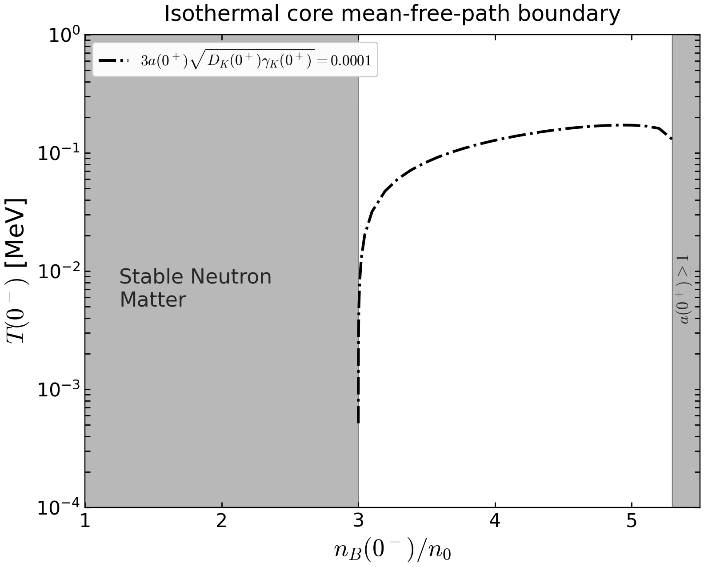

The saved calculation has **33 successful roots**, with sampled temperatures from **0.515 keV to 0.172 MeV**.
The maximum relative criterion residual is $5.63\times10^{-7}$; all 24 static-region slices also passed their checks.
No moving-front BVP is used here.

The tolerance $10^{-4}$ is not a universal LTE cutoff, nor is it a spatial definition based on reaching 10% of the interface composition or gradient.
It is also distinct from the appendix's local diffusion-gradient condition.
A true profile-based validity assessment would need the relevant gradients throughout a solved front.

> **Say:** The tail does not produce the proposed low-temperature crossing. The core can behave oppositely, and we now have a tunable core scale-separation diagnostic, but it should not be presented as a sharp physical breakdown boundary.

Sources: [notebook](26-10-14.ipynb), cells 3 and 5 for the tail calculation/plot, and cells 7 and 8 for the core calculation/plot (**zero-based cell numbering**); [method and validation details](wiki/methods/isothermal-mfp-overlay.md); [calculation README](new_paper_calculations/26-10-14/README.md).

---

## 7. Isothermal Log-Temperature Plot

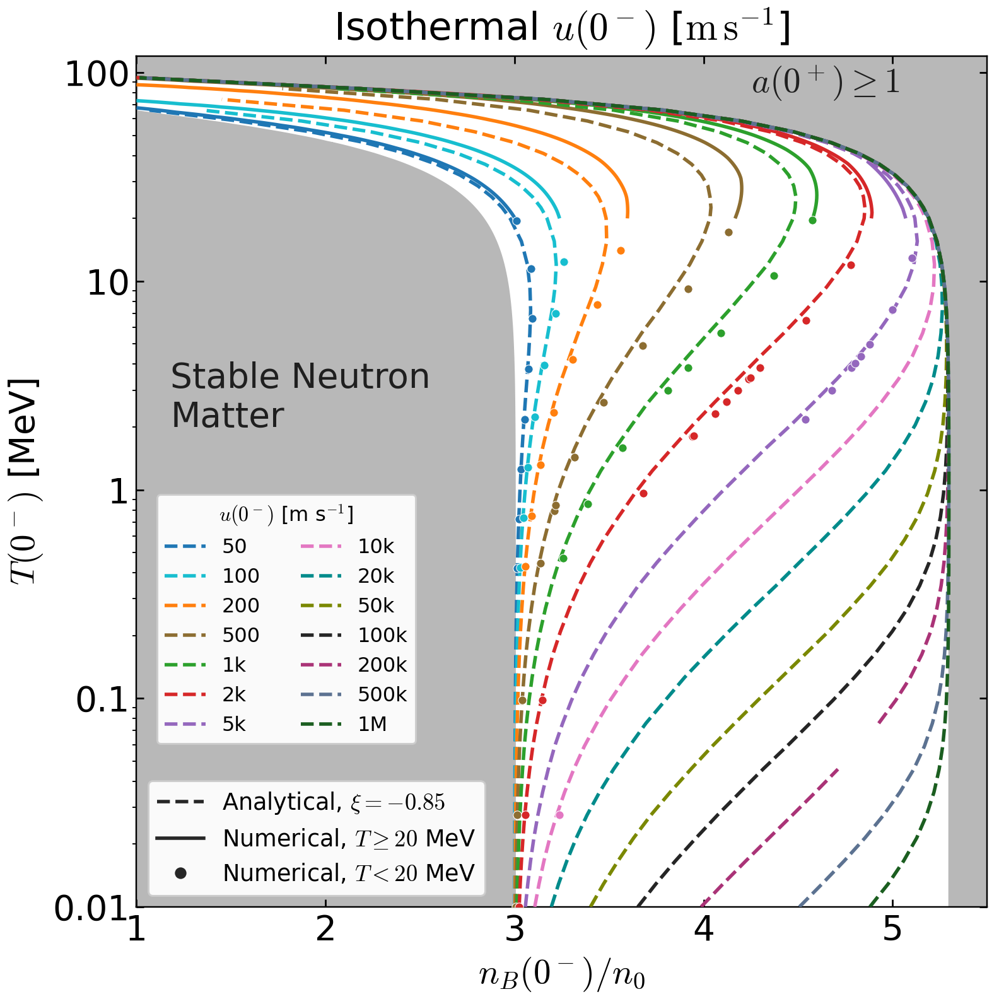

This saved-data plot preserves the analytical contours at $\xi=-0.85$, the warm numerical curves, and the accepted cold numerical dots.
The logarithmic axis makes the low-temperature behavior visible without compressing it against zero.
Gray regions mark stable neutron matter and the unit-composition exclusion.
The highest analytical contour levels should not be described as fully numerically validated merely because they are drawn.

The absence of an added tail-crossing curve is consistent with the small ratios in the bounded tests above; the embedded output itself is a saved-contour preview, not evidence that the full scheduled tail scan finished.

**Presentation/export files:** [current PNG](26-10-14.assets/isothermal-log-contours.png), [current notebook PDF export](local_analysis_results/26-10-14/isothermal-contours-mfp-tail.pdf), and [earlier analytical/numerical PDF](local_analysis_results/26-10-02/isothermal-analytic-numerical-logT.pdf).
The Overleaf upload is marked complete in the checklist; these links identify the local exports rather than asserting that the local main manuscript includes this figure.

> **Say:** The log-temperature comparison is available for the paper and meeting. Numerical curves and individual cold points are distinguished from the analytical continuation.

Source: [notebook](26-10-14.ipynb), cells 1 and 5; [high-speed contour provenance](wiki/methods/isothermal-high-speed-contours.md) and [cold-point audit](wiki/methods/isothermal-notebook-cold-points.md).

---

## Additional Check: Accuracy of Eq. (35)

**The 1% accuracy claim does not hold across the checked isothermal states.**
Here the reference is the exact static composition ceiling, obtained from the neutral EOS by matching pressure and the average chemical potential:

$$
P_{\rm QM}(0^+)=P(0^-),\qquad
\mu_B(0^-)=\mu_B(0^+)+A_{\rm iso}^{\rm exact}\mu_K(0^+).
$$

Eq. (35) estimates that ceiling using the equilibrated endpoint:

$$
A_{\rm iso}^{\rm Eq.\,(35)}
=3\sqrt{\left[\frac{\mu_B(0^-)}{\mu_B(\infty)}-1\right]
\frac{\mu_B^2(\infty)+3\pi^2T^2}{\mu_B^2(\infty)+9\pi^2T^2}}.
$$

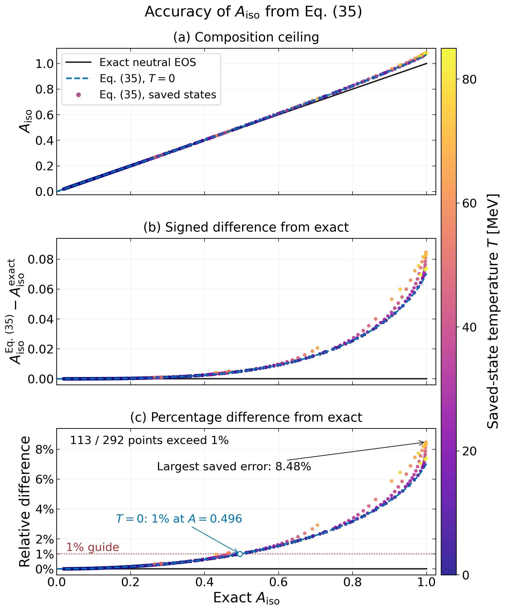

*All panels use exact composition on the horizontal axis. The black reference is the identity in the upper panel and zero in the difference panels. Colored points are 292 audited saved states, spanning 0.01–83.86 MeV; they are not interpolated into temperature curves. The blue dashed curve is the cold limit, and the red dotted line marks 1% relative error.*

The middle panel plots the signed difference $A_{\rm iso}^{\rm Eq.\,(35)}-A_{\rm iso}^{\rm exact}$.
The lower panel uses the **exact ceiling as its denominator**:

$$
100\left(\frac{A_{\rm iso}^{\rm Eq.\,(35)}}{A_{\rm iso}^{\rm exact}}-1\right)\%.
$$

At $T=20\,\mathrm{MeV}$ and $U_{\rm bag}^{1/4}=189.1566\,\mathrm{MeV}$:

| Exact ceiling | Eq. (35) | Relative difference |
|---:|---:|---:|
| 0.41135 | 0.41418 | +0.69% |
| 0.56578 | 0.57359 | +1.38% |
| 0.86552 | 0.90094 | +4.09% |
| 0.98928 | 1.05633 | +6.78% |

Of the 292 successful targets in this checkpoint, **113 exceed 1% error**, with a largest error of **8.48%**.
The plotted $T=10\,\mathrm{MeV}$, $n_B(0^-)=3n_0$ trajectory is a good small-composition example: its error is only **0.0802%** at exact composition 0.146108.
At zero temperature, the error reaches 1% at exact composition **0.495544**; this threshold is not a temperature-independent bound.
Approximate values above one are displayed without clipping, since they show where the expansion fails to respect the physical composition range.

The independent EOS calculation reproduces the saved exact ceilings within $1.1\times10^{-11}$, so numerical tolerance cannot explain these differences.
The production solver already solves for the exact static ceiling; the disagreement concerns the manuscript's explicit Taylor formula and does not mean these numerical front calculations used the approximate ceiling.

> **Say:** The formula works well near equilibrium, but we cannot claim 1% across the full range. Keep the exact EOS ceiling for numerical work and remove the blanket accuracy claim from the analytical discussion.

Sources: [notebook](26-10-14.ipynb), cells 11–12; [PDF export](local_analysis_results/26-10-14/aiso-accuracy.pdf); [all audited points](local_analysis_results/26-10-16/aiso-accuracy/results.json); [independent calculation](local_analysis_results/26-10-16/aiso-accuracy/audit.py); [Wolfram checks](local_analysis_results/26-10-16/aiso-accuracy/verification.wl).

---

## Backup Figures

### Local Rate Errors at the Lower Baryon Chemical Potential

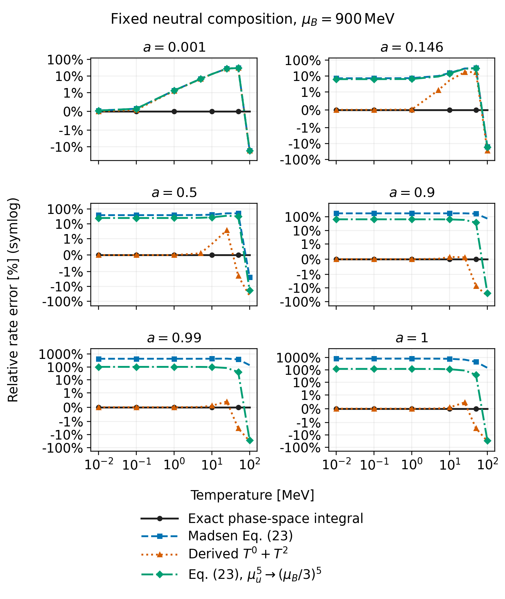

*Standalone derivation, Fig. 2. Same conventions as the 1200 MeV comparison in item 2.*

### Isolating Adiabatic Diffusion Weighting

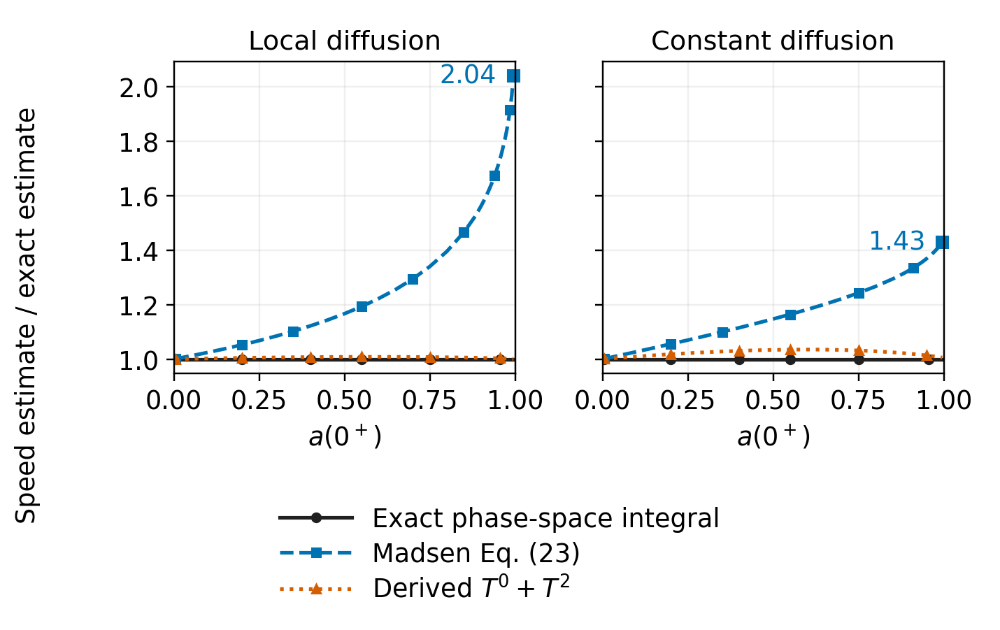

*Standalone derivation, Fig. 7. Only the diffusion weighting changes between panels; the thermodynamic paths and rate prescriptions are unchanged.*

### Why One Profile Factor Cannot Fit Every Speed

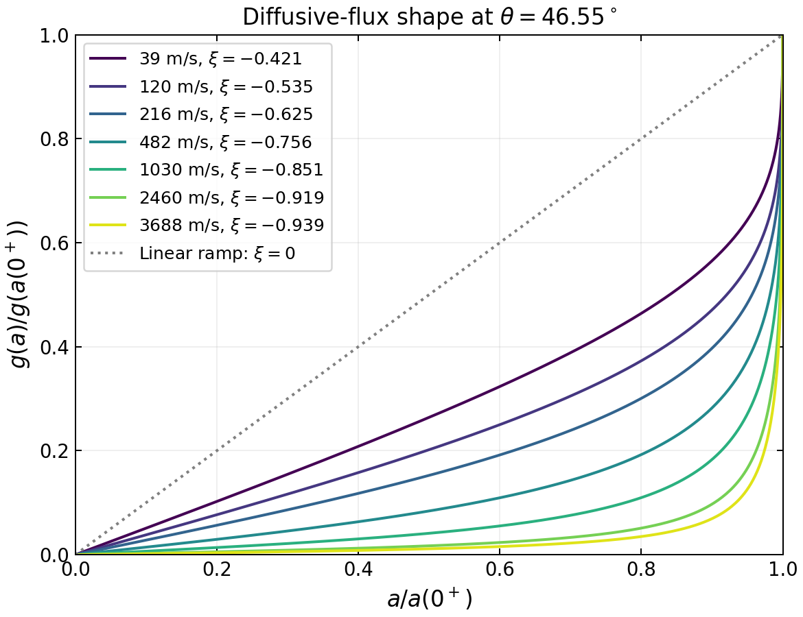

*Existing profile-shape diagnostic. Use the numerical shapes to discuss the speed dependence; any comparison to the older constant in this historical figure is not the new fitting result above.*

## Source Map

| Material | Authoritative local source |
|---|---|
| Full rate derivation, coefficients, comparisons | [standalone PDF](ref-list/massless-weak-rate/Main.pdf), [LaTeX entry point](ref-list/massless-weak-rate/Main.tex) |
| Fresh full-integral collaborator data | [CSV package README](local_analysis_results/26-10-15/massless-phase-space/README.md) |
| Adiabatic conserved-trajectory calculation | [derivation section](ref-list/massless-weak-rate/adiabatic-section.tex) |
| Isothermal log plot, tail and core diagnostics | [26-10-14 notebook](26-10-14.ipynb), [helper README](new_paper_calculations/26-10-14/README.md) |
| Constant-profile-factor comparison | [saved score report](local_analysis_results/26-10-12/xi-optimum/band-output.txt) |
| Eq. (35) ceiling accuracy | [audit results](local_analysis_results/26-10-16/aiso-accuracy/results.json), [plot source](new_paper_calculations/26-10-14/aiso_accuracy_plot.py) |
| Figure provenance and hashes | [asset manifest](26-10-14.assets/manifest.json) |

All embedded figures are local files in `26-10-14.assets/`.
The original comparison plots are unchanged; the profile-factor scan renders saved predictions, the constant-momentum-flux plot redraws archived vector coordinates, and the Eq. (35) comparison plots the audited EOS ceilings.
[prepare_assets.py](26-10-14.assets/prepare_assets.py) recreates the asset set without new EOS or BVP solves.
