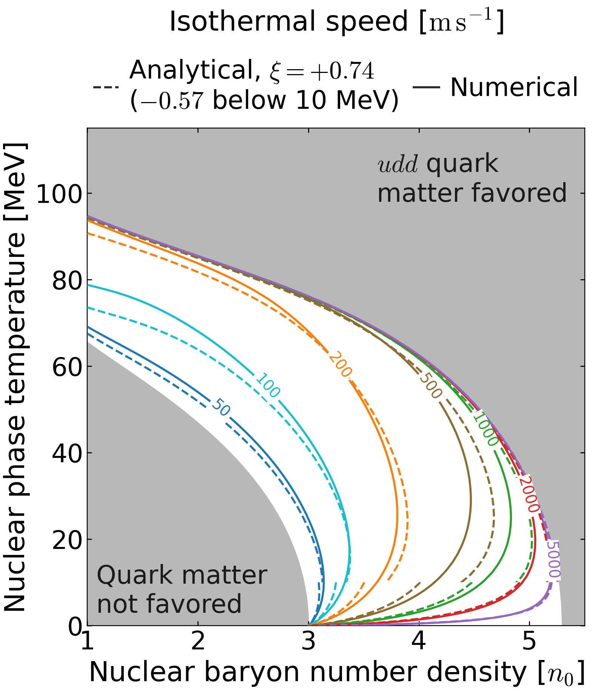
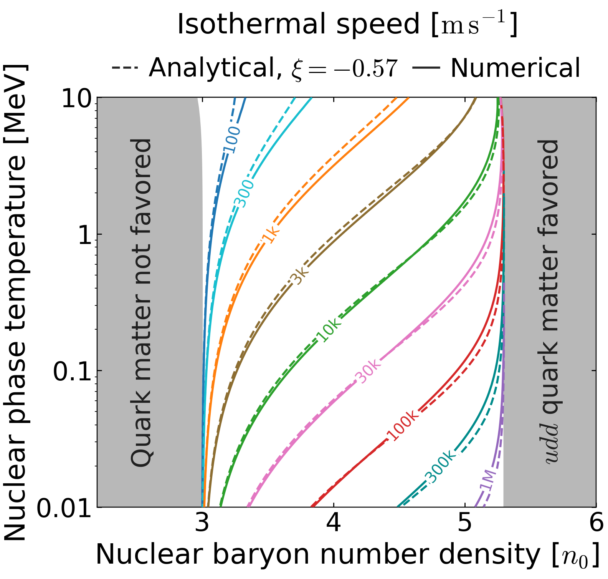
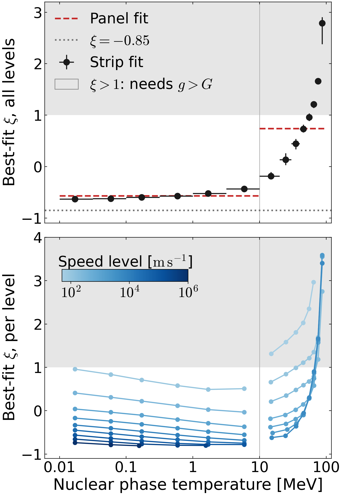
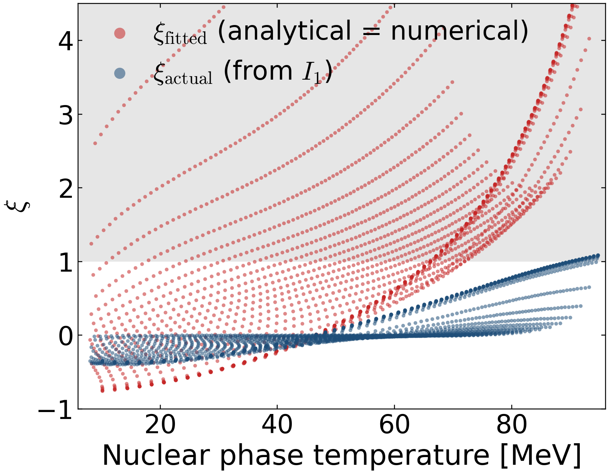
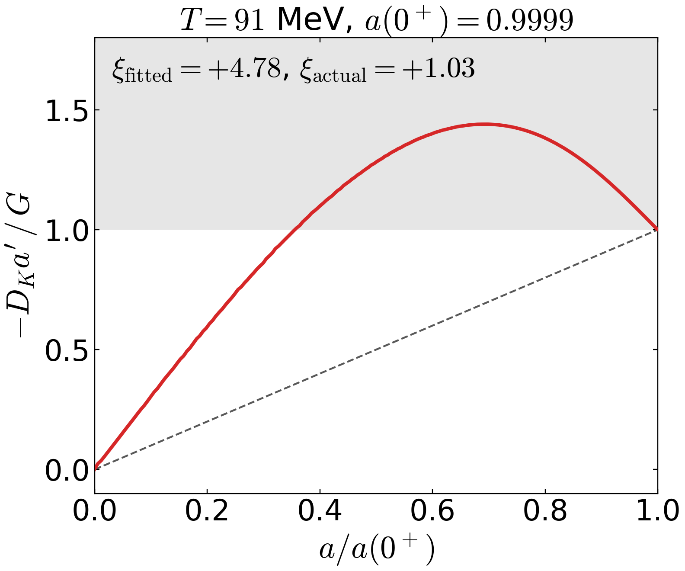
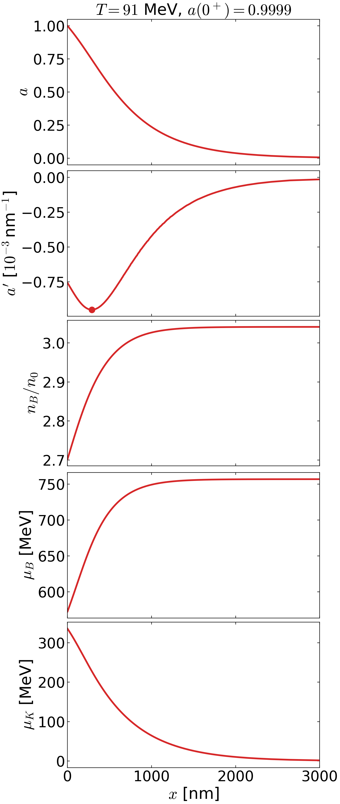

# Isothermal front speed: numerical results and the temperature dependence of $\xi$

*2026-11-01.*

- **Numerical speeds:** `solve_front_isothermal_slow(initial_guess_mode="auto")`.
- **Analytical speeds:** `analytic_velocity_isothermal_slow`, from `RMFsolver` [v4.9.6].
- **Physics inputs:** massless quarks, QMC-RMF3 pure neutron matter, $\alpha_s=0.4$, the revised Madsen rate and the non-relativistic equations.
- **Meshes:**
  - high $T$ (8–100 MeV): a polar mesh, with 99.6% of points converged;
  - low $T$ (0.01–10 MeV): 40 logarithmic rows, with 94% of points converged.

No solver was rerun for this report.

The analytical speed depends on $\xi$ only through

$$
u(0^-;\xi)=\frac{\sqrt{2I_2}}{\lambda_n\sqrt{\big[1-a(0^+)\big]\big[1+\xi\,a(0^+)\big]}} ,
$$

where $I_2$, $\lambda_n$ and $a(0^+)$ do not depend on $\xi$. Every $\xi$ below is therefore an exact rescaling of the saved analytical grid.

$\xi$ is fitted by minimizing the RMS displacement of the plotted contours along the mesh rays or rows; offsets are quoted in $n_0$. If the diffusive flux $g=-D_Ka'$ rises monotonically in $a$, from 0 to its interface value $G=\lambda_n u(0^-)\big[1-a(0^+)\big]$, then $-1<\xi<1$ (`Main.tex` appendix).

## 1. High temperature, linear $T$



At the high-$T$ contour fit, $\xi=+0.74$, the RMS contour offset is $0.078\,n_0$ (maximum $0.34\,n_0$). At $\xi=-0.85$ it is $0.29\,n_0$. The 100–1000 m/s contours remain visibly off, with per-level RMS offsets up to $0.11\,n_0$.

Below 10 MeV the dashed curves use the low-$T$ fit, which is why they jump at the seam.

## 2. Low temperature, logarithmic $T$



At the low-$T$ contour fit, $\xi=-0.57$, the analytical contours nearly sit on the numerical ones: the RMS offset is $0.031\,n_0$ (maximum $0.13\,n_0$), against $0.092\,n_0$ at $\xi=-0.85$. The residual misfit is spread evenly over the levels, with per-level RMS offsets of $0.02$–$0.04\,n_0$.

## 3. $\xi$ in temperature strips



**Top panel.** One $\xi$ per strip, fitted to every plotted-contour crossing whose temperature lies in the strip. The strips are half-decades below 10 MeV and 10 MeV wide above, with 80–95 MeV merged. Horizontal bars mark the strip; vertical bars give the 16–84% range over 400 bootstrap resamples of the rays or rows.

**Bottom panel.** The same fit for each speed level on its own. The gray band, $\xi>1$, would require $g>G$ somewhere inside the layer.

| $T$ strip [MeV] | $\xi$ | 16–84% | crossings | RMS at strip $\xi$ [$n_0$] | at panel $\xi$ | at $\xi=-0.85$ |
|---|---|---|---|---|---|---|
| 0.01–0.032 | $-0.63$ | $-0.63$ to $-0.63$ | 63 | 0.018 | 0.024 | 0.070 |
| 0.032–0.1 | $-0.62$ | $-0.63$ to $-0.62$ | 63 | 0.021 | 0.024 | 0.074 |
| 0.1–0.32 | $-0.60$ | $-0.60$ to $-0.59$ | 62 | 0.022 | 0.023 | 0.079 |
| 0.32–1 | $-0.57$ | $-0.58$ to $-0.56$ | 56 | 0.026 | 0.026 | 0.091 |
| 1–3.2 | $-0.52$ | $-0.53$ to $-0.51$ | 55 | 0.031 | 0.032 | 0.102 |
| 3.2–10 | $-0.43$ | $-0.45$ to $-0.42$ | 49 | 0.041 | 0.053 | 0.132 |
| 10–20 | $-0.18$ | $-0.23$ to $-0.10$ | 43 | 0.068 | 0.153 | 0.215 |
| 20–30 | $+0.13$ | $+0.03$ to $+0.26$ | 44 | 0.070 | 0.106 | 0.255 |
| 30–40 | $+0.44$ | $+0.33$ to $+0.54$ | 50 | 0.066 | 0.074 | 0.288 |
| 40–50 | $+0.73$ | $+0.67$ to $+0.82$ | 54 | 0.055 | 0.055 | 0.308 |
| 50–60 | $+0.96$ | $+0.89$ to $+1.04$ | 63 | 0.047 | 0.053 | 0.310 |
| 60–70 | $+1.21$ | $+1.14$ to $+1.26$ | 74 | 0.038 | 0.059 | 0.315 |
| 70–80 | $+1.66$ | $+1.62$ to $+1.71$ | 86 | 0.023 | 0.087 | 0.322 |
| 80–95 | $+2.79$ | $+2.38$ to $+2.91$ | 129 | 0.004 | 0.033 | 0.261 |

The "panel $\xi$" column uses $-0.57$ below 10 MeV and $+0.74$ above.

## Physics

**One trend, not two regimes.** $\xi$ rises steadily with $T$ over four decades, from $-0.63$ at 0.01 MeV to $+1.66$ at 70–80 MeV.
- The two panel fits are averages over different parts of this one trend.
- The trend crosses the 10 MeV seam between the two meshes without a jump: $-0.43$ at 3–10 MeV, then $-0.18$ at 10–20 MeV.
- Per speed level, the two meshes agree at the seam to within $0.16$.

**Below 10 MeV, the front speed sets $\xi$.** At fixed $T$, $\xi$ falls with speed. In the coldest strip it goes from $+0.96$ at 100 m/s to $-0.74$ at $10^6$ m/s; read as a profile shape, a faster front builds its diffusive flux later in the conversion layer.
- At fixed speed, $\xi$ even decreases slightly as $T$ rises.
- The strip value still drifts upward because the fastest contours, which want the most negative $\xi$, stop crossing the rows: $10^6$ m/s above 0.24 MeV and $3\times10^5$ m/s above 2.9 MeV.

**Above 10 MeV, $\xi$ rises with $T$ at every speed level**, and above about 60 MeV the fit exceeds $+1$. The next section explains why.
- The 80–95 MeV value is weakly constrained. The contours crowd against the upper boundary, so the offsets are small for any $\xi$: $0.004\,n_0$ at its own fit and $0.033\,n_0$ at $+0.74$.

**Consequence.**
- For the 0.01–10 MeV comparison, a single $\xi=-0.57$ is adequate.
- Above 10 MeV no constant $\xi$ follows the trend. The fitted $\xi$ there mostly corrects the analytical $I_2$, not the profile shape.

## Why the fitted $\xi$ exceeds 1

The parameterization $I_1=\tfrac{1+\xi}{2}Ga(0^+)$ confines $\xi$ to $(-1,1)$ only if $g=-D_Ka'$ never exceeds its interface value $G$. The fitted $\xi$ is a different quantity: it makes the whole analytical formula reproduce the numerical speed, so it also absorbs the formula's other approximations. At each high-$T$ point we compare two values:
- $\xi_{\rm fitted}$: the value at which the analytical formula gives the numerical speed;
- $\xi_{\rm actual}=2I_1/\big(G\,a(0^+)\big)-1$: the value the solved profile actually has, with the manuscript definitions applied literally to the saved solver profile. Here $g=-D_Ka'$ with $a'$ by finite differences, $I_1=\int D_Ka'^2\,dx$ and $G=g(0^+)$.

The second figure is one actual numerical profile, the 91 MeV point with $a(0^+)=0.9999$, drawn as the parametric curve $\big(a(x),g(x)\big)$ for $0^+\le x<\infty$. Finite differences on the saved 256-point grids reproduce $J_K=u\,n_K-D_Kn_K'$ and $J_K'=-\Gamma_K$ to a median 0.3% and 0.15% (99th percentile 7% and 1.3%, at the steepest parts of the grid).





Of 2282 high-$T$ points, 1408 have $\xi_{\rm fitted}>1$, but only 59 have $\xi_{\rm actual}>1$, all above 90 MeV and none above $+1.09$.

**$\xi_{\rm fitted}>1$ comes from $I_2$, not the shape.** At 48–71 MeV, profiles with $\xi_{\rm fitted}=1.5$–$2.1$ are straight ramps, with $\xi_{\rm actual}\approx0$ and $g\le G$.
- The analytical $I_2$ uses the cubic manuscript rate with transport frozen at $\mu_B(0^+)$. The numerical $I_2=\int D_K\Gamma_K\,da/n_B(0^+)$ integrates the full local rate along the profile.
- Where $\xi_{\rm fitted}>1$, the analytical $I_2$ is larger by a median factor of 1.6, or 1.8 at 50–70 MeV. Since $u^2\propto I_2/(1+\xi a)$, an $I_2$ that is too large forces $\xi$ above 1.
- Using $n_B(\infty)$ in $\lambda_n$ adds a further factor of about 1.1 to $\lambda_n^2$.
- When $a(0^+)$ is small (slow fronts near coexistence), $1+\xi a$ barely depends on $\xi$. A modest $I_2$ error then needs a very large $\xi$, which is why the 50–100 m/s contours want $\xi$ up to $+2$ and more.

**The flux is not always monotone (second figure).** In 831 of the 2282 profiles, $g$ peaks inside the layer, although $a(x)$ is monotone in all of them.
- A monotone $a(x)$ only guarantees $g>0$, hence $\xi>-1$; the bound $\xi<1$ also needs $g\le G$.
- Near $a(0^+)\to1$ the peak reaches up to 1.47 $G$. The area under $g$ still stays close to the rectangle $Ga(0^+)$, so $\xi_{\rm actual}$ reaches $0.6$–$1.0$ and crosses 1 only marginally above 90 MeV.
- The appendix statement that every exact solution gives $-1<\xi<1$ is therefore only marginally violated, but its premise of a monotone $g$ fails for about a third of the high-$T$ profiles.

**The same profile against $x$.**



- $a(x)$ is monotone but has an inflection point. $|a'|$ is largest at $x\approx290$ nm (dot), where it is 1.25 times its value at $0^+$.
- $D_K$ rises by 27% across the layer, which lifts the peak of $-D_Ka'$ to 1.44 $G$.
- Within about 1000 nm, $n_B$ rises by 12.5% and $\mu_B$ rises from 572 to 757 MeV. $\mu_K$ falls more slowly, from 336 MeV to nearly 0 by about 2000 nm.
- The 77 and 84 MeV profiles look the same, on layers of about $0.1$ and $0.3$ times this width.

**Why the current grows into the layer.** The solver uses $a=n_K/n_B$, $J_K=j_Ba-D_Kn_K'$ and $J_K'=-\Gamma_K$. Together these give exactly
$$(-D_Kn_K')'=j_B|a'|-\Gamma_K .$$
The diffusive current therefore grows wherever advection brings in K faster than conversion removes it.
- In the three peaked profiles, the two terms balance at $0^+$ (ratio 1.00–1.03) and advection wins just inside. The current $-D_Kn_K'$ peaks at 1.75–2.19 times its value at $0^+$.
- In the slow ramps (48–71 MeV, 50–100 m/s), conversion wins at $0^+$ (ratio 0.40–0.84), and the current only decreases.
- On the saved profiles this balance closes to better than 0.2% of $\Gamma_K(0^+)$.

⚠ **The definitions are ambiguous where $n_B$ varies.** Above 72 MeV, $n_B$ changes by up to 13% across the layer. The manuscript's $g=-D_Ka'$ then differs from the solver's diffusive current per baryon, $-D_Kn_K'/n_B$. The jump-condition $G=\lambda_n u(0^-)[1-a(0^+)]$ with $\lambda_n=n_B(0^-)/n_B(0^+)$ fixes the solver's flux, not $-D_Ka'$; the latter is 1.15–1.56 times larger at $x=0^+$ when $a(0^+)\ge0.99$. With the solver's flux and the jump-condition $G$ (record field `xi_profile`), 343 points give $\xi_{\rm actual}>1$, up to $+1.59$. Whether a near-boundary profile exceeds $\xi=1$ thus depends on how $I_1$ and $G$ are generalized to varying $n_B$; the non-monotone flux appears with either definition.

## Reproduce

```bash
PYTHONPATH=local_analysis_results/26-10-02/runtime/scipy-1.18.1-cpython-312-darwin-arm64:. \
./bin/python3 -B new_paper_calculations/26-10-27/isothermal/xi_fit/fit_xi_strips.py    # 25 s -> xi_strips.json
PYTHONPATH=local_analysis_results/26-10-02/runtime/scipy-1.18.1-cpython-312-darwin-arm64:. \
./bin/python3 -B new_paper_calculations/26-10-27/isothermal/xi_fit/report_figures.py   # the three figures
PYTHONPATH=local_analysis_results/26-10-02/runtime/scipy-1.18.1-cpython-312-darwin-arm64:. \
./bin/python3 -B new_paper_calculations/26-10-27/isothermal/xi_fit/xi_gt1_profiles.py   # xi_fitted vs xi_actual, flux profiles
```

The panel fits come from `xi_fit/fit_xi.py` (`xi_fit.json`).
